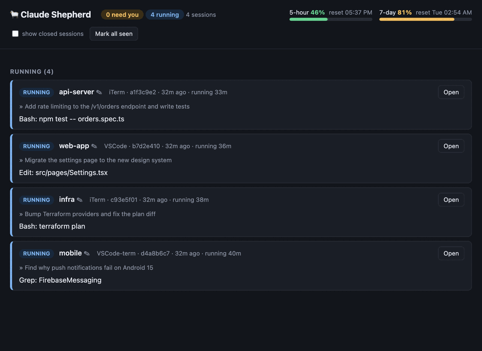

# 🐑 Claude Shepherd

> **Herd your Claude Code agents.** Running 5 sessions at once? Know instantly which one is done, which is waiting for permission, and jump straight to it.

**English** · [Tiếng Việt](README.vi.md)

[](https://github.com/trantholock/claude-shepherd/actions/workflows/ci.yml)
[](LICENSE)




Keep track of every **Claude Code** session you run in parallel (iTerm, the VS Code extension, the VS Code terminal) so you never miss an agent that has finished or is waiting on you.

- **Claude Code hooks** write each session's state to `~/.claude/ccmon/sessions/<session_id>.json`
- **macOS notifications** when an agent finishes a turn or needs permission
- **Web dashboard** at http://127.0.0.1:7788
- **Desktop app** "Claude Shepherd": its own window, a Dock badge and a menu bar icon; click a session to jump to its iTerm tab or VS Code window
- **Plan quota** (5-hour / 7-day, same as `/usage`) in the app header, window title, menu bar, web dashboard and the Claude Code status line
- **Session names** you choose (✎ on the dashboard, right-click → Rename… in the app, or `ccmon name`)
- **Remote Control sessions** started from your phone or claude.ai can be resumed in an iTerm tab with one click (see [below](#remote-control-sessions))
- **`ccmon` CLI**

- **English and Vietnamese** UI — more translations welcome

## Requirements

- macOS 14 or later
- Xcode Command Line Tools (`xcode-select --install`)
- Claude Code
- No third-party Python packages: everything runs on the system `/usr/bin/python3` (3.9+)

## Install

```bash
git clone https://github.com/trantholock/claude-shepherd.git
cd claude-shepherd
make install     # ccmon + hooks + LaunchAgent + build the app
```

Other targets:

```bash
make app         # rebuild the app after editing app/*.swift or the icon
make check       # run the same lint/build checks as CI
make uninstall   # remove hooks, LaunchAgents and the app (keeps ~/.claude/ccmon data)
```

`~/bin/ccmon` is a symlink to `ccmon/ccmon` in this repo, so changes to the CLI and hook take effect immediately. The background web dashboard needs a restart:

```bash
launchctl kickstart -k gui/$(id -u)/io.github.trantholock.ccmon
```

`make install` edits `~/.claude/settings.json` idempotently and keeps a timestamped backup next to it.

## Session states

| State | Hook event | Meaning |
|---|---|---|
| Running | `UserPromptSubmit`, `PreToolUse`, `PostToolUse` | the agent is working; shows the current tool |
| Waiting for you | `Notification` (permission) | needs permission or an answer |
| Done | `Stop` | finished the turn; shows the last reply |
| Interrupted | transcript contains `Request interrupted by user` | you pressed Esc mid-turn |
| Open, idle | `SessionStart` | a newly opened session |
| Closed | `SessionEnd`, or the claude PID is gone | removed after 24h |

`●` means unseen. A session is marked seen when you click **Open** / **Seen**, or when you send a new prompt.

## Remote Control sessions

When `claude remote-control` is running on your Mac, you can start a new session from the Claude mobile app or claude.ai/code. That session runs on the Mac in the background. ccmon recognises it from the `--sdk-url …/code/sessions/cse_…` argument and labels it **Remote**.

Clicking a Remote session in the app, or **Terminal** on the dashboard, opens a new iTerm tab that runs `claude --resume <id>` in the session's folder:

- **Idle or done:** the background worker is stopped first, then the same session is resumed. The conversation moves to the terminal, so you can no longer continue it from your phone.
- **Running or waiting for permission:** the worker is left alone and the tab opens with `--fork-session`. You get a copy that has the full history, and the original keeps going.

To open the session in the browser instead, use **Web** on the dashboard or right-click → Open on web in the app.

To keep `claude remote-control` running all the time, start it from a LaunchAgent with `caffeinate -is` and send its stdout to `/dev/null`. Its screen output redraws constantly and would otherwise grow the log by tens of MB a day.

## CLI

```
ccmon [ls] [-a]        status table (-a includes closed sessions)
ccmon watch            table that refreshes every 2s
ccmon serve [port]     web dashboard (default 7788)
ccmon focus <id>       jump to the session's iTerm tab / VS Code window (Remote: resume in iTerm)
ccmon term <id>        open the session in a new iTerm tab (claude --resume)
ccmon ack [id|all]     mark as seen
ccmon clean            delete closed sessions
ccmon name <id> [name] set a session name (empty name = clear it)
ccmon usage            5h / 7d quota
ccmon lang [en|vi|auto] UI language
ccmon statusline       (used as Claude Code's statusLine command)
```

## Quota and session names

After each turn Claude Code sends JSON to the `statusLine` command, including `rate_limits.five_hour|seven_day` (`used_percentage`, `resets_at`) and `session_name`. `ccmon statusline` stores the quota in `~/.claude/ccmon/usage.json`, per-session data in `~/.claude/ccmon/statusline/<id>.json`, and prints a line like `📌 name · 🟢 5h 46% (reset 14:10) · 🟠 7d 81% · ctx 12%`.

- The quota only updates while at least one Claude session is active; after the reset time it shows 0%.
- `make install` only sets `statusLine` if you don't already have your own.
- Display name priority: your custom name (`~/.claude/ccmon/names.json`) > Claude's `session_name` > folder name.

To disable macOS notifications, set `CCMON_NOTIFY=0` in Claude Code's environment.

## Language

The CLI, notifications, web dashboard and app follow your macOS language (English by default, Vietnamese if macOS is set to Vietnamese). To override it:

```bash
ccmon lang vi     # or: en, auto
```

This is saved in `~/.claude/ccmon/config.json`; restart the app and `ccmon serve` to apply. `CCMON_LANG=en|vi` in the environment takes precedence.

## Project layout

```
ccmon/ccmon                 CLI + hook + web server (Python stdlib, 3.9 compatible)
app/ClaudeShepherd.swift      SwiftUI app (Window + MenuBarExtra), reads the ccmon serve API
app/icon.swift              draws the icon with AppKit -> build/AppIcon.icns
app/Info.plist
launchd/*.plist.tmpl        LaunchAgents: ccmon serve + open the app at login
scripts/install.sh          full install
scripts/build-app.sh        builds the app into build/ and copies it to ~/Applications
scripts/hooks.py            add/remove hooks + statusLine in ~/.claude/settings.json
scripts/uninstall.sh
```

## API (`ccmon serve`)

The server only listens on `127.0.0.1`.

- `GET  /api/sessions?all=0|1` → `{now, rows: [...], usage}`
- `POST /api/ack?id=<id|all>`, `/api/forget?id=`, `/api/focus?id=`, `/api/term?id=`, `/api/rename?id=&name=` (requires the `X-CCMon: 1` header)

## Troubleshooting

- Sessions opened before the hooks were installed only appear after their next prompt. In VS Code, run **Reload Window**.
- The first time you focus or open an iTerm tab, macOS asks for Automation permission → Allow.
- Notifications may be listed under "Script Editor" in System Settings → Notifications.
- Hook errors are logged to `~/.claude/ccmon/hook-errors.log`; the hook never breaks a Claude session.

## Contributing

Contributions are welcome! Please read [CONTRIBUTING.md](CONTRIBUTING.md) and our [Code of Conduct](CODE_OF_CONDUCT.md). To report a security issue, see [SECURITY.md](SECURITY.md).

## License

[MIT](LICENSE). This is a community project and is not affiliated with or endorsed by Anthropic. "Claude" is a trademark of Anthropic.
