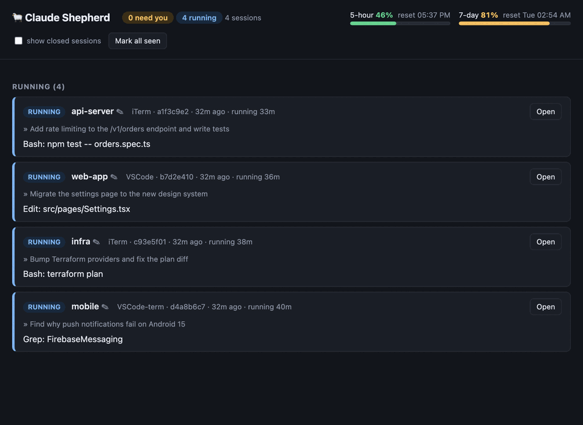

# 🐑 Claude Shepherd

> **Chăn đàn agent Claude Code của bạn.** Chạy 5 phiên cùng lúc? Biết ngay phiên nào đã xong, phiên nào đang chờ cấp quyền, và nhảy thẳng tới đó.

[English](README.md) · **Tiếng Việt**

[](https://github.com/trantholock/claude-shepherd/actions/workflows/ci.yml)
[](LICENSE)



Theo dõi trạng thái mọi phiên **Claude Code** đang chạy song song (iTerm, VSCode extension, terminal trong VSCode) để không bỏ sót agent nào đã xong hoặc đang chờ bạn.

- **Hook** của Claude Code ghi trạng thái từng phiên vào `~/.claude/ccmon/sessions/<session_id>.json`
- **Thông báo macOS** khi agent xong lượt hoặc cần cấp quyền
- **Dashboard web** http://127.0.0.1:7788
- **App desktop** "Claude Shepherd": cửa sổ riêng + badge trên Dock + biểu tượng trên menu bar, bấm vào phiên để nhảy tới đúng tab iTerm / cửa sổ VSCode
- **Quota gói Claude** (5 giờ / 7 ngày, giống `/usage`) trên header app, tiêu đề cửa sổ, menu bar, dashboard web và statusLine của Claude Code
- **Đặt tên phiên** cho dễ nhớ (✎ trên dashboard, chuột phải → Đổi tên… trong app, hoặc `ccmon name`)
- **CLI** `ccmon`

## Cài đặt

```bash
git clone https://github.com/trantholock/claude-shepherd.git
cd claude-shepherd
make install
```

Cần macOS 14+, Xcode Command Line Tools (`xcode-select --install`), không cần thư viện Python ngoài (chạy bằng `/usr/bin/python3`).

```bash
make install     # ccmon + hook + LaunchAgent + build app
make app         # build lại app sau khi sửa app/*.swift hoặc icon
make uninstall   # gỡ hook, LaunchAgent, app (giữ dữ liệu ~/.claude/ccmon)
```

`~/bin/ccmon` là symlink vào `ccmon/ccmon` của repo này, nên sửa CLI/hook là có hiệu lực ngay. Riêng dashboard web chạy nền thì cần khởi động lại: `launchctl kickstart -k gui/$(id -u)/io.github.trantholock.ccmon`.

## Trạng thái

| Trạng thái | Sự kiện hook | Ý nghĩa |
|---|---|---|
| ĐANG CHẠY | `UserPromptSubmit`, `PreToolUse`, `PostToolUse` | agent đang làm, hiện tool đang chạy |
| CHỜ BẠN | `Notification` (permission) | cần cấp quyền / trả lời |
| XONG | `Stop` | xong lượt, hiện câu trả lời cuối |
| BỊ NGẮT | transcript có `Request interrupted by user` | bạn bấm Esc giữa chừng |
| MỞ, CHƯA LÀM | `SessionStart` | phiên mới mở |
| ĐÃ ĐÓNG | `SessionEnd` hoặc PID claude không còn | tự xóa sau 24h |

`●` = chưa xem. Phiên chuyển sang "đã xem" khi bấm **Mở**/**Đã xem**, hoặc khi bạn gửi prompt mới.

## CLI

```
ccmon [ls] [-a]       bảng trạng thái (-a gồm cả phiên đã đóng)
ccmon watch           bảng tự làm mới 2s
ccmon serve [port]    dashboard web (mặc định 7788)
ccmon focus <id>      nhảy tới tab iTerm / cửa sổ VSCode của phiên
ccmon ack [id|all]    đánh dấu đã xem
ccmon clean           xóa phiên đã đóng
ccmon name <id> [tên] đặt tên phiên (bỏ trống = xóa tên tự đặt)
ccmon usage           quota 5h / 7 ngày
ccmon lang [en|vi|auto] ngôn ngữ giao diện
ccmon statusline      (dùng cho statusLine của Claude Code)
```

## Quota & tên phiên

Claude Code gửi JSON cho lệnh `statusLine` sau mỗi lượt, có `rate_limits.five_hour|seven_day` (`used_percentage`, `resets_at`) và `session_name`. `ccmon statusline` ghi quota vào `~/.claude/ccmon/usage.json`, dữ liệu theo phiên vào `~/.claude/ccmon/statusline/<id>.json`, và in ra dòng `📌 tên · 🟢 5h 46% (reset 14:10) · 🟠 7d 81% · ctx 12%`.

- Quota chỉ cập nhật khi có ít nhất 1 phiên Claude đang hoạt động; đã qua giờ reset thì hiện 0%.
- `make install` chỉ đặt statusLine khi bạn chưa có statusLine riêng.
- Tên hiển thị: tên tự đặt (`~/.claude/ccmon/names.json`) > `session_name` Claude tự đặt > tên thư mục.

Tắt thông báo macOS: đặt `CCMON_NOTIFY=0` trong môi trường của Claude Code.

## Ngôn ngữ

CLI, thông báo, dashboard và app theo ngôn ngữ chính của macOS (mặc định tiếng Anh, tiếng Việt nếu macOS đặt tiếng Việt). Để chọn cố định:

```bash
ccmon lang vi     # hoặc: en, auto
```

Lưu ở `~/.claude/ccmon/config.json`; khởi động lại app và `ccmon serve` để áp dụng. Biến môi trường `CCMON_LANG=en|vi` được ưu tiên hơn.

## Cấu trúc

```
ccmon/ccmon                 CLI + hook + web server (Python stdlib, tương thích 3.9)
app/ClaudeShepherd.swift      app SwiftUI (Window + MenuBarExtra), đọc API của ccmon serve
app/icon.swift              vẽ icon bằng AppKit -> build/AppIcon.icns
app/Info.plist
launchd/*.plist.tmpl        LaunchAgent: ccmon serve + tự mở app khi đăng nhập
scripts/install.sh          cài toàn bộ
scripts/build-app.sh        build app vào build/ rồi chép sang ~/Applications
scripts/hooks.py            thêm/gỡ hook + statusLine trong ~/.claude/settings.json (idempotent, có backup)
scripts/uninstall.sh
```

## API (ccmon serve)

- `GET  /api/sessions?all=0|1` → `{now, rows: [...]}`
- `POST /api/ack?id=<id|all>`, `/api/forget?id=`, `/api/focus?id=`, `/api/rename?id=&name=` (bắt buộc header `X-CCMon: 1`)

## Ghi chú

- Phiên mở trước khi cài hook chỉ xuất hiện sau prompt tiếp theo. VSCode cần Reload Window.
- Lần đầu focus tới iTerm macOS sẽ hỏi quyền Automation → Allow.
- Thông báo có thể nằm dưới tên "Script Editor" trong System Settings → Notifications.
- Lỗi hook ghi vào `~/.claude/ccmon/hook-errors.log`; hook không bao giờ làm hỏng phiên Claude.

## Đóng góp

Mọi đóng góp đều được chào đón — xem [CONTRIBUTING.md](CONTRIBUTING.md) và [Quy tắc ứng xử](CODE_OF_CONDUCT.md). Báo lỗi bảo mật: [SECURITY.md](SECURITY.md).

## Giấy phép

[MIT](LICENSE). Đây là dự án cộng đồng, không liên kết hay được Anthropic bảo trợ. "Claude" là nhãn hiệu của Anthropic.
